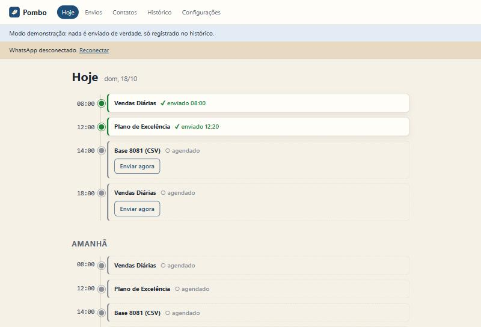
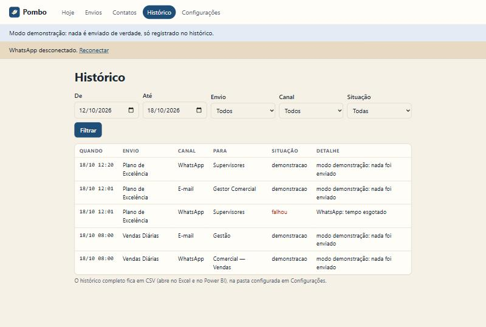
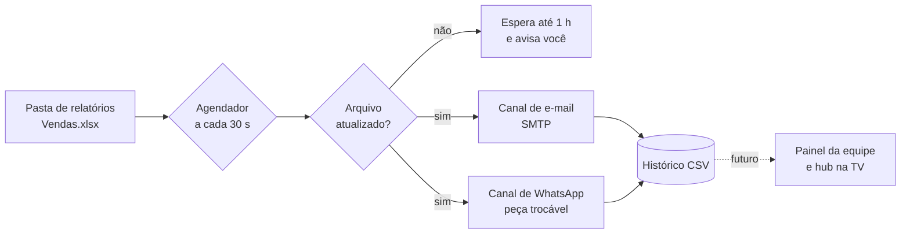

<p align="center">
  
</p>

<h1 align="center">Pombo</h1>

<p align="center"><strong>Seus relatórios chegam sozinhos.</strong><br>
Envia planilhas por e-mail e WhatsApp no horário certo, só quando o arquivo foi atualizado, e registra tudo.</p>

<p align="center">
  
</p>

---

## O problema

Todo dia útil, depois que a empresa fecha, um analista de dados atualiza os relatórios em Excel e distribui à mão:
anexa no e-mail, copia e cola a mesma mensagem, depois manda de novo no WhatsApp, grupo por grupo.

São **~10 minutos por rodada**, todo dia. Às vezes **alguém fica de fora**. E a rodada do meio do dia, que ajudaria o time comercial, **nunca acontece**, porque toma tempo demais.

## A solução

Você cadastra uma vez **o quê** (arquivos), **para quem** (listas de e-mail, contatos e grupos de WhatsApp), **quando** (dias e horários) e **com qual mensagem**. O Pombo cuida do resto:

- **Envia no horário**, por e-mail e WhatsApp, com `{saudacao}`, `{data}` e `{arquivos}` preenchidos sozinhos.
- **Nunca manda número velho sem avisar.** Se o arquivo não foi atualizado hoje, ele espera (confere a cada 15 min por até 1 h), depois desiste e **avisa você**, com um botão "Enviar mesmo assim".
- **Nunca reenvia.** O estado vem do histórico; reiniciar o PC no meio de uma rodada não duplica nada.
- **Tenta de novo** quando a rede falha (3 vezes, a cada 5 min) e avisa se não conseguir.
- **Histórico em CSV** por analista e por mês: abre no Excel, entra no Power BI e alimenta o futuro painel da equipe.
- **Modo demonstração**: faz tudo, menos enviar de verdade.
- **Roda sem administrador** no PC do trabalho: dois cliques para instalar, dois para abrir.

<p align="center">
  
</p>

## Como funciona



Detalhes em [docs/arquitetura.md](docs/arquitetura.md).

## Instalação (Windows, sem administrador)

1. Instale o **Python 3.12 ou 3.13** marcando **"Install for me only"** (não precisa de admin). Versões mais novas podem ainda não ter todas as bibliotecas prontas. [Passo a passo](docs/instalacao.md).
2. Baixe este projeto: botão verde **Code › Download ZIP** e extraia.
3. Dois cliques em **`instalar.bat`**.
4. Dois cliques em **`iniciar.bat`**. O Pombo abre no navegador.
5. Em **Configurações**: seu e-mail de envio, QR code do WhatsApp e "Abrir com o Windows".

Primeira vez num PC novo? Siga [docs/primeiro-uso.md](docs/primeiro-uso.md).

### Quer só ver funcionando?

No **Prompt de Comando** (cmd):

```bat
set POMBO_DADOS=%TEMP%\pombo-demo
.venv\Scripts\python -m tools.seed_demo
.venv\Scripts\python -m pombo
```

No **PowerShell**:

```powershell
$env:POMBO_DADOS = "$env:TEMP\pombo-demo"
.venv\Scripts\python -m tools.seed_demo
.venv\Scripts\python -m pombo
```

Cria uma pasta separada com envios, contatos e histórico **fictícios**, em modo demonstração. O script se recusa a escrever por cima de um cadastro de verdade.

## Documentação

| Documento | Para quem |
|---|---|
| [Ganho de tempo](docs/ganho-de-tempo.md) | Gestão: quanto o Pombo economiza, com a conta |
| [WhatsApp hoje e com investimento](docs/whatsapp-hoje-e-com-investimento.md) | Gestão e TI: automação atual × API oficial da Meta |
| [Arquitetura](docs/arquitetura.md) | Quem vai manter o código |
| [Segurança e dados](docs/seguranca-e-dados.md) | TI: onde fica cada coisa, o que nunca sai do PC |
| [Limitações](docs/limitacoes.md) | Todos: o que o Pombo não faz (ainda) |
| [Roadmap](docs/roadmap.md) | Próximas fases, até o hub da equipe na TV |
| [Decisões técnicas](docs/decisoes.md) | Por que cada escolha foi feita |

## Para desenvolvedores

```bat
.venv\Scripts\python -m pip install -r requirements-dev.txt
.venv\Scripts\python -m pytest
```

Python 3.12 ou 3.13 · FastAPI · Jinja2 · neonize (WhatsApp) · smtplib · keyring · pytest.
Mais de 100 testes automáticos cobrem as regras que mais podem errar: horários, arquivo atualizado, novas tentativas, envio perdido e "nunca reenviar".
O desenho completo está em [docs/superpowers/specs](docs/superpowers/specs) e o plano de construção em [docs/superpowers/plans](docs/superpowers/plans).

## Aviso sobre o WhatsApp

O Pombo automatiza um número de WhatsApp comum conectado como "aparelho conectado". Isso **não é a API oficial** e vai contra os termos de uso do WhatsApp. Use um número corporativo dedicado, apenas com pessoas que conhecem o número, e nunca para disparo em massa. O caminho oficial está documentado em [docs/whatsapp-hoje-e-com-investimento.md](docs/whatsapp-hoje-e-com-investimento.md).

---

Feito por **Kayo Ibiapino**, analista de dados, para tirar da rotina o que uma máquina faz melhor.
