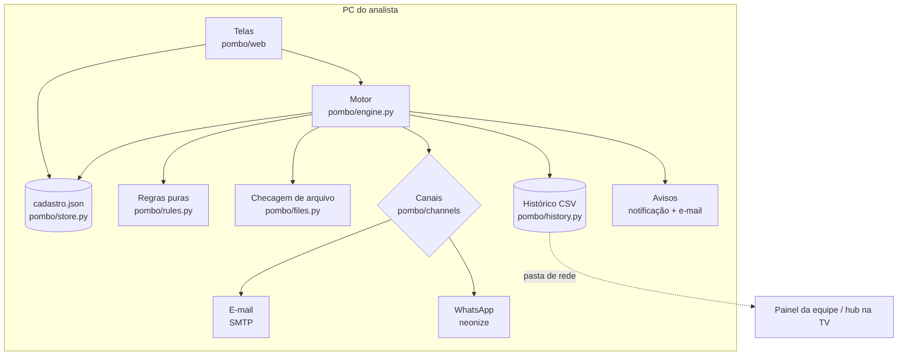

# Arquitetura

O Pombo é **um único programa Python** que roda no PC do analista. Ele tem duas partes que funcionam juntas:

- **Telas**: um site local (FastAPI + Jinja2) aberto só em `127.0.0.1:8765`. Nada fica exposto na rede.
- **Motor**: uma thread que, a cada 30 segundos, decide o que enviar.



## O caminho de um envio

1. **Agendador.** A cada 30 s o motor olha cada envio ativo e cada horário de hoje que já chegou.
2. **Já saiu?** Ele lê o **histórico** dessa rodada. Destinatário que já tem `enviado` é pulado. O estado do sistema *é* o histórico: não existe outro lugar onde ele possa ficar dessincronizado.
3. **Perdido?** Rodada sem nenhum registro e horário passado há mais de 2 h (PC desligado, por exemplo) vira `perdido` e não sai sozinha. A tela oferece "Enviar agora".
4. **Arquivo pronto?** Nas checagens de `agendado + 0, 15, 30, 45 e 60 min`, cada arquivo precisa existir, não estar vazio, não estar aberto no Excel e ter sido **modificado hoje, depois do último envio que deu certo**. A segunda parte impede que a rodada das 18h "aproveite" a atualização feita para a das 14h.
   - Não está pronto → `esperando`. Na checagem de 60 min → `desistiu` e o analista é avisado uma vez.
5. **Envio.** Cada destinatário passa pelo canal dele. Resultado: `enviado`, `falhou` (tenta de novo a cada 5 min, até 4 tentativas) ou `esperando` quando o canal está fora do ar (WhatsApp desconectado não gasta tentativas).
6. **Registro.** Cada resultado vira uma linha no CSV.

## A peça trocável de canal

Todo canal tem o mesmo formato (`pombo/channels/__init__.py`):

```python
class Channel(Protocol):
    name: str
    def send(self, target: Target, subject: str, message: str, files: list[Path], use_bcc: bool = True) -> None: ...
```

O motor não sabe como um canal funciona por dentro. Por isso, **migrar para a API oficial do WhatsApp é escrever outra classe com esse formato**, sem mexer no resto (ver [whatsapp-hoje-e-com-investimento.md](whatsapp-hoje-e-com-investimento.md)). O mesmo vale para trocar o servidor de e-mail.

## O histórico: o contrato com o futuro

`<pasta do histórico>/<analista>/<AAAA-MM>.csv`, em UTF-8 com BOM (o Excel abre os acentos certos). Colunas:

`data_hora, analista, envio, horario_agendado, canal, destinatario, arquivos, status, detalhe, envio_id`

- Cada analista grava só no próprio arquivo. Por isso vários PCs podem usar a **mesma pasta de rede** sem banco de dados.
- Se o CSV estiver travado (o chefe abriu no Excel), as linhas esperam num arquivo local de pendentes e são gravadas depois. Nenhuma linha se perde e nada é reenviado.
- Mudanças futuras **só acrescentam colunas no fim**, para não quebrar quem já lê o arquivo (Power BI, painel).

## Onde está cada coisa

| Pasta/arquivo | Responsabilidade |
|---|---|
| `pombo/__main__.py` | Inicia tudo, garante uma única cópia aberta (porta 8765 exclusiva) |
| `pombo/engine.py` | Motor: decide e registra |
| `pombo/rules.py` | Regras puras: horários, atualização, novas tentativas, mensagem |
| `pombo/files.py` | O arquivo está pronto? (existe, vazio, aberto no Excel, rede fora) |
| `pombo/history.py` | CSV de histórico + pendentes |
| `pombo/channels/` | E-mail e WhatsApp |
| `pombo/alerts.py` | Avisos para o analista |
| `pombo/winsys.py` | Impedir suspensão, abrir com o Windows (sem admin) |
| `pombo/web/` | Telas |
| `tools/` | Teste de conexão, dados de exemplo, demonstração |
| `tests/` | Testes automáticos (pytest) |
