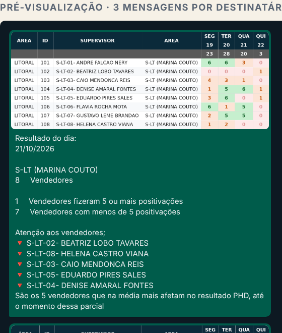
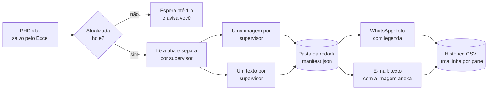

# Mensagens com print da planilha e texto calculado

O caso que motivou: o **PHD** (positivação representante dia). Todo dia até as 9h o analista
filtra a planilha por supervisor, oculta colunas para deixar só a semana, tira um print,
gera um texto com fórmulas ("Resultado do dia", quantos fizeram 5 ou mais, os 5 que mais
afetam a média) e manda print + texto no grupo, **um supervisor de cada vez**.

Agora o Pombo faz isso sozinho, no horário, e só se a planilha foi atualizada.

  

## Como funciona

1. **Lê a planilha** (`openpyxl`, valores que o Excel salvou; não precisa do Excel aberto).
2. **Escolhe as colunas** fixas (ex.: `B:E`), os **dias da semana** do resultado até hoje
   (ex.: na quinta, seg a qui) e, se quiser, colunas no fim (ex.: a média).
3. **Separa por um valor** (ex.: coluna `E`, o supervisor). Pode limitar a alguns valores e
   escolher a ordem de envio.
4. **Desenha a tabela** numa imagem nítida para celular, com as cores do PHD: dia na meta
   verde, abaixo laranja, zero rosa, e a linha de totais do grupo.
5. **Calcula o texto** com os campos abaixo e envia **foto + legenda** para cada destinatário.

### Campos da mensagem

| Campo | O que vira |
|---|---|
| `{valor}` | o valor da divisão (ex.: o supervisor) |
| `{referencia}` | a data do resultado (ontem ou hoje, como escolhido) |
| `{linhas}` | quantas linhas (vendedores) |
| `{acima}` / `{abaixo}` | quantos ficaram na meta / abaixo, pela média |
| `{limite}` | a meta por dia (ex.: 5) |
| `{piores}` / `{melhores}` | lista com 🔻 / 🔺 dos de média mais baixa / mais alta |
| `{qtd_piores}` | quantos nomes entraram em `{piores}` |
| `{media}` | média do grupo |
| `{total_dia}` | soma do dia de referência no grupo |
| `{saudacao}` `{data}` `{hora}` `{ontem}` | valem em qualquer envio |

"Média" é a média dos dias mostrados até a data de referência, ou a coluna que você indicar em
**Coluna da média**.

### "Ontem" e a segunda-feira

Com **Resultado de: ontem**, a referência é o último dia de venda: na segunda, é o sábado. Os dias
mostrados são os da semana da referência, até hoje. Na segunda às 9h o print mostra a semana
passada inteira (seg a sáb).

## Passo a passo (PHD)

1. **Envios › Novo envio**, dê um nome (ex.: "PHD por supervisor").
2. Deixe **Arquivos** vazio.
3. Escolha o grupo, os dias (seg a sex) e o horário (ex.: `08:45`).
4. Abra **Print da planilha com texto calculado** e clique em **Preencher com o modelo do PHD**.
   Ele marca o print, preenche linhas e colunas do desenho atual do PHD e escreve a mensagem.
5. Cole o caminho da planilha em **Planilha** e salve.
6. Clique em **Pré-visualizar o print**: aparece cada mensagem como vai chegar no grupo.
7. **Enviar teste só para mim** manda tudo só para o seu WhatsApp/e-mail.

Se a planilha mudar de desenho (linhas ou colunas), ajuste os números e letras e pré-visualize de novo.

## Garantias que continuam valendo

- **Nunca reenvia.** Cada par (destinatário, supervisor) tem a sua linha no histórico. Se a rede cair
  no terceiro supervisor, só o terceiro em diante sai de novo.
- **Mesmo print na rodada inteira.** As imagens e os textos ficam numa pasta da rodada
  (`%LOCALAPPDATA%\Pombo\recortes`). Se o PC reiniciar no meio, quem falta recebe exatamente o mesmo
  conteúdo. Pastas com mais de 30 dias são apagadas sozinhas.
- **Planilha com problema não vira mensagem errada.** Aba sumida, coluna errada ou nenhuma linha:
  a rodada para, aparece na tela Hoje e você recebe o aviso. Arrumou? **Enviar mesmo assim**.
- **Mensagem só de texto.** Envio sem arquivo e sem print manda só a mensagem (lembretes, avisos).

## Escolhas técnicas (e alternativas avaliadas)

| Opção | Prós | Contras | Decisão |
|---|---|---|---|
| **Desenhar a tabela com Pillow** | roda sem Excel, rápido, testável, igual em todo PC | não copia formatação personalizada da planilha | **escolhida** |
| Copiar o intervalo como imagem pelo Excel (automação COM) | fica idêntico à planilha | precisa do Excel aberto e destravado, quebra com pop-ups, não dá para testar fora do Windows | guardada como opção futura ("modo Excel") |
| HTML + navegador sem tela | visual livre | precisa de um navegador instalado, mais lento e pesado | descartada |
| Recalcular o PHD direto da base 8081 | dispensa a planilha | cada analista tem a sua regra; vira um sistema de BI | fica para o Hub/Power BI |

Os valores vêm do que o Excel **salvou**. Planilha com fórmulas precisa ter sido aberta e salva no Excel
depois de atualizar (é o que o analista já faz hoje). A fase 2 do roadmap (o Pombo abrir o Excel e
"Atualizar tudo") resolve até isso.

## Próximos passos possíveis

Ver [roadmap.md](roadmap.md), seção "Mensagens programadas".
