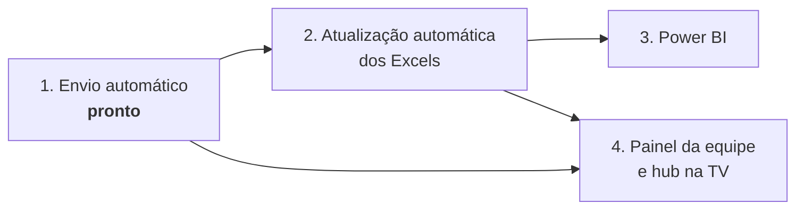

# Roadmap

## Fase 1: Envio automático ✅

Este projeto. Arquivos, destinatários, horários, checagem de atualização, histórico.

## Mensagens programadas ✅ (primeira parte)

Pronto: print da planilha separado por supervisor, texto calculado, mensagens só de texto,
pré-visualização e teste. Ver [mensagens-com-print.md](mensagens-com-print.md).

Próximos passos, do mais útil para o menos:

1. **Modelos prontos por rotina**: além do PHD, "positivações por pasta às 15h e 17h" e
   "comparativo de rotas" como botões de preencher, para cada analista começar em segundos.
2. **Regras de cor por coluna** (hoje a cor vale só nos dias): ex. média abaixo da meta em vermelho.
3. **Condição para enviar**: só manda se `{abaixo}` > 0, ou só para supervisores com alguém abaixo.
4. **Menções** no grupo (`@supervisor`) usando o contato cadastrado.
5. **E-mail com a imagem no corpo** (hoje vai como anexo) e um e-mail só com todas as partes.
6. **"Modo Excel"**: copiar o intervalo como imagem pelo próprio Excel, para planilhas com
   formatação que o desenho do Pombo não reproduz.
7. **Agendamento por data** (dia 10 do mês, último dia útil) além de dias da semana.

## Fase 2: Atualização automática dos Excels

Hoje os relatórios usam planilhas com consultas ligadas aos dados extraídos do ERP (Winthor, rotina 8081) e do BI (TARGIT). Antes de enviar, o Pombo poderia:

1. Abrir cada planilha no Excel (automação do Excel pelo Python, sem admin).
2. Atualizar todas as consultas ("Atualizar tudo") e esperar terminar.
3. Salvar e fechar. A regra de "arquivo atualizado" fica satisfeita e o envio sai.

**Por que importa:** é isso que **libera a rodada das 14h**, que hoje não existe porque custa tempo demais.

## Fase 3: Power BI

A base CSV da rotina 8081 (vendas por RCA, supervisor, cliente, produto, fornecedor) é o formato ideal para o Power BI. O histórico do Pombo também é CSV e pode virar um painel de "quem recebeu o quê, e quando".

## Fase 4: Painel da equipe → Hub "API" (Analistas da Polybalas Integrados)

Um app na **TV da sala dos analistas** mostrando, por analista:

- presença (veio hoje, está na sala, está em reunião)
- **envios feitos hoje**, lidos direto do histórico do Pombo
- tarefas em andamento
- **avisos sonoros na tela**, como "enviar o PHD" e "transferir pedidos", com confirmação de feito

Cada analista monta o próprio perfil e escolhe o que aparece.

**O que já está pronto para isso:** o histórico do Pombo pode ficar numa **pasta de rede compartilhada** (Configurações › Pasta do histórico), um arquivo por analista. O hub só precisa ler esses CSVs. Não é preciso servidor nem banco de dados para começar.
